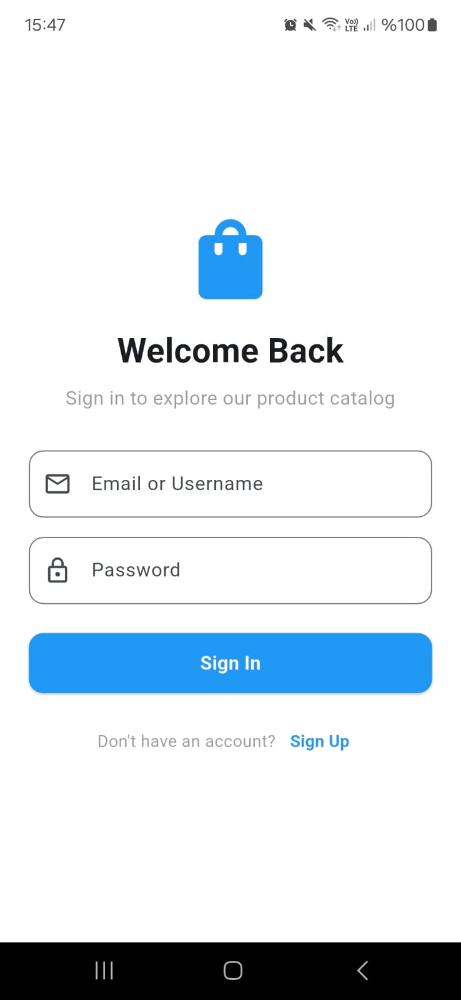
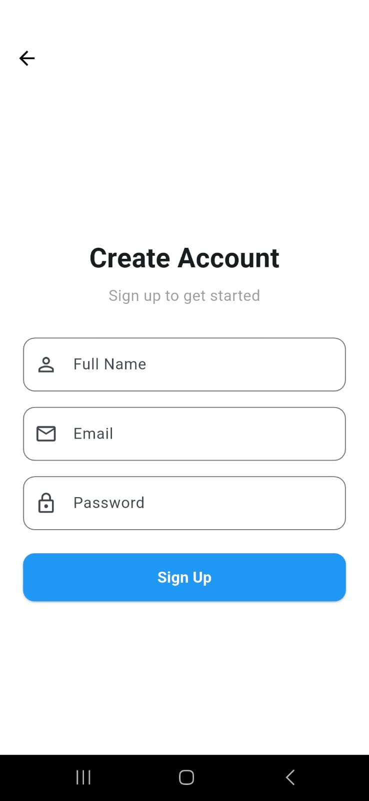
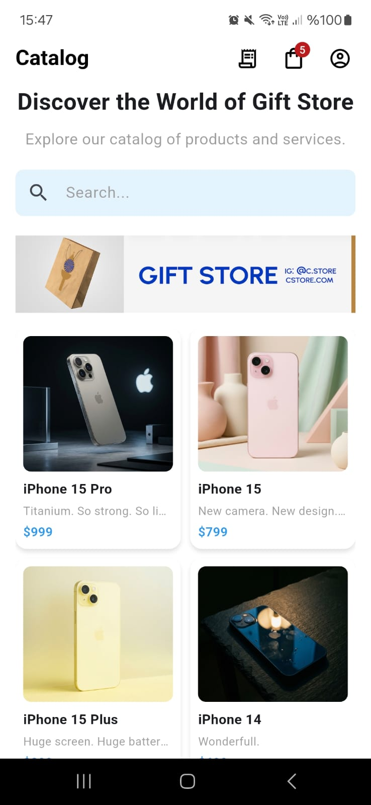
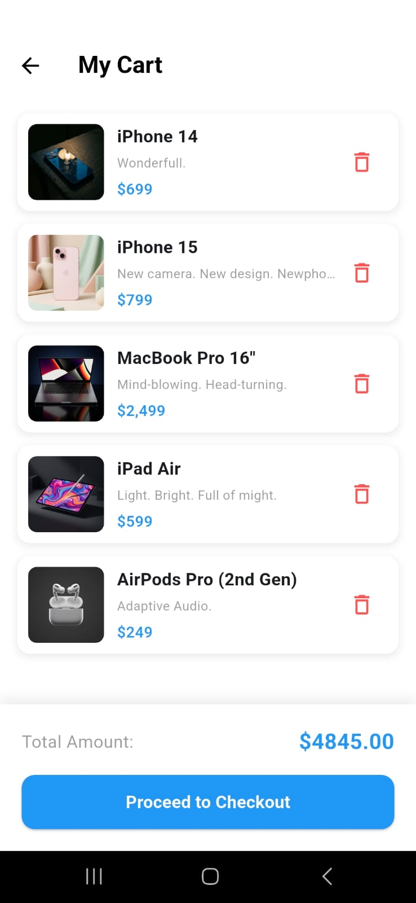
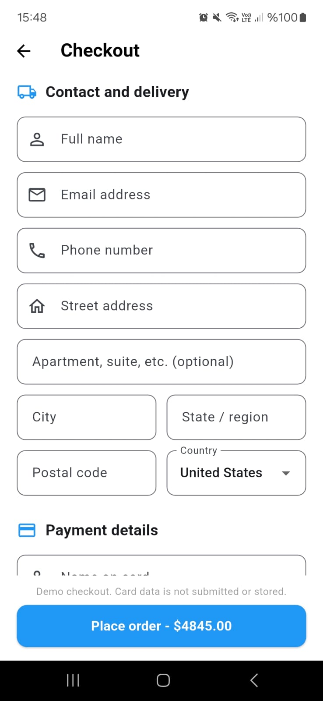
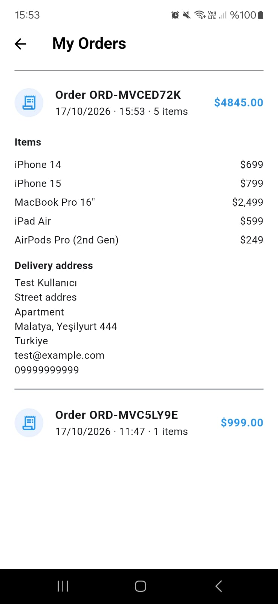

# Mini Katalog Uygulaması

Flutter ile geliştirilmiş; ürün kataloğu, kalıcı sepet, demo checkout ve sipariş geçmişi içeren mobil uygulama.

Uygulamanın özellikleri, proje mimarisi, klasör yapısı ve çalıştırma adımları için [uygulama README'sine](catalog_app/README.md) göz atın.

## Özellikler

- Hesap oluşturma ve yerel oturum yönetimi
- Ürün kataloğunda arama ve ürün detaylarını görüntüleme
- Uygulama yeniden açıldığında korunan sepet
- Teslimat bilgileri içeren demo checkout
- Tamamlanan siparişleri ve teslimat ayrıntılarını gösteren sipariş geçmişi

> Ödeme akışı demo amaçlıdır. Gerçek ödeme alınmaz; kart bilgileri gönderilmez veya saklanmaz.

## Ekran Görüntüleri

### Giriş ve Kayıt

<table>
	<tr>
		<th>Giriş</th>
		<th>Kayıt</th>
	</tr>
	<tr>
		<td></td>
		<td></td>
	</tr>
</table>

### Katalog ve Ödeme

<table>
	<tr>
		<th>Ana Sayfa</th>
		<th>Sepet</th>
		<th>Checkout</th>
	</tr>
	<tr>
		<td></td>
		<td></td>
		<td></td>
	</tr>
</table>

### Siparişler

<table>
	<tr>
		<th>Sipariş Geçmişi</th>
	</tr>
	<tr>
		<td></td>
	</tr>
</table>
